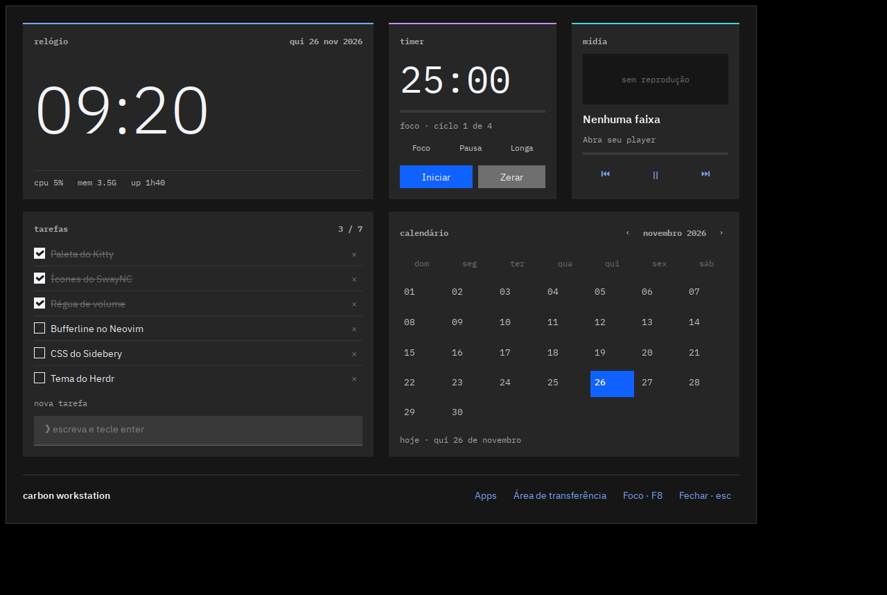
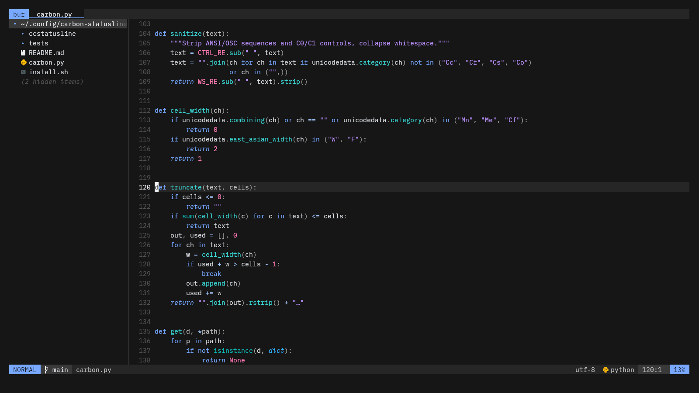
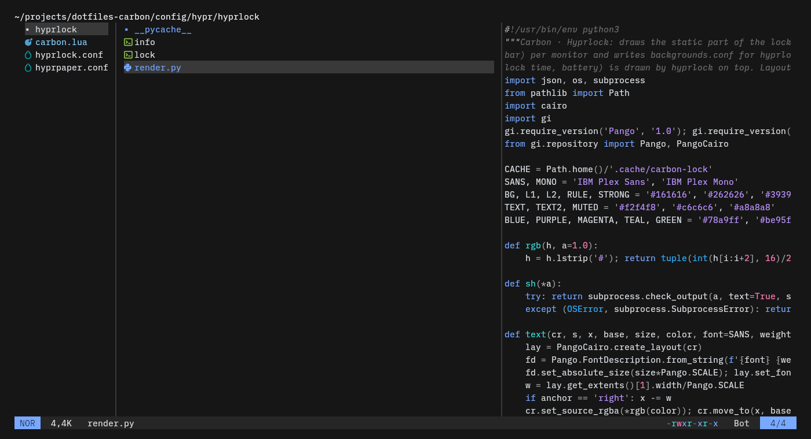
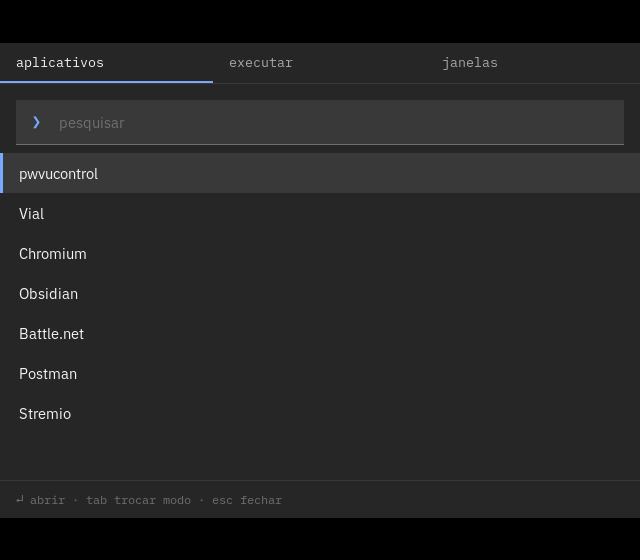
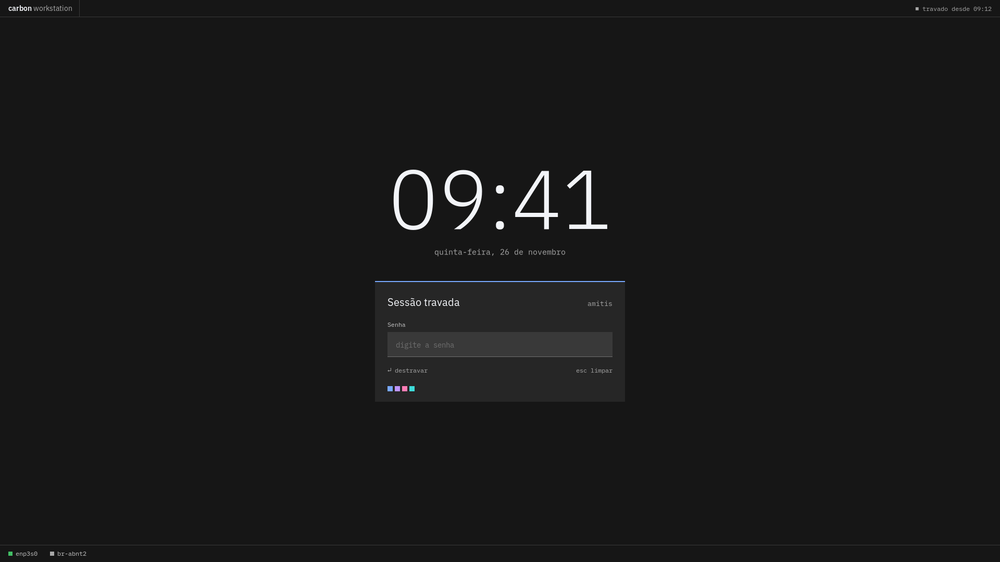

# Carbon workstation

Hyprland dotfiles in the **Oxocarbon** palette, laid out like the IBM Carbon g100 design system:
`#161616` canvas, layers `#262626` / `#393939`, IBM Plex Sans for content, IBM Plex Mono for labels
and data. Corners are square and there is no blur or shadow. Everything is separated by 1px rules,
and one color stands for each kind of thing. It continues the Oxocarbon theme of the Heráclio app.



| Surface | Carbon pattern |
|---|---|
| Waybar | UI Shell header: **full width, flush to the top**, 1px rule below, product name, workspaces as nav items with a 2px blue rule under the active one |
| Hyprland | 4/8 gaps, 2px `#78a9ff` border on the focused window, no rounding or blur |
| Dashboard (GTK) | Tiles on layer 01, Plex Sans Light display clock, primary/secondary/ghost buttons, structured list, calendar |
| Rofi | Tabs, search field with bottom rule, menu rows with a 3px blue indicator |
| SwayNC | Toasts on layer 02 with a 3px status rule, quick toggles, the Carbon pill toggle |
| Hyprlock | Header, display clock, sign-in tile with a Carbon text input, status bar |
| Kitty / Fish / Starship | Plex Mono, Oxocarbon ANSI set, breadcrumb prompt with the app's `❯` |
| Neovim | `carbon` colorscheme (below), Lualine theme, Carbon tabline |
| Yazi / Bat / Btop | Selection on layer 02, Oxocarbon syntax colors |
| Firefox + Sidebery, GTK 3, Herdr | Same tokens |

| Token | Hex | Role |
|---|---|---|
| background | `#161616` | Canvas |
| layer 01 / 02 / 03 | `#262626` `#393939` `#4c4c4c` | Tiles, fields and selection, hover |
| text / secondary / placeholder | `#f2f4f8` `#a8a8a8` `#6f6f6f` | |
| blue | `#78a9ff` | Interactive, focus rule, keywords |
| purple | `#be95ff` | Strings, timer, git branch |
| magenta | `#ff7eb6` | Constants, search hit |
| teal | `#3ddbd9` | Functions, media, commands |
| cyan / sky | `#33b1ff` `#82cfff` | Types, properties |
| green / orange / pink | `#42be65` `#ff832b` `#ee5396` | Success, warning, error |

<table><tr>
<td width="50%"></td>
<td width="50%"></td>
</tr><tr>
<td></td>
<td></td>
</tr></table>

## Neovim: `carbon`

`config/nvim/colors/carbon.lua` builds on [oxocarbon.nvim](https://github.com/nyoom-engineering/oxocarbon.nvim) (MIT). It keeps the palette and makes these changes:

- Carbon layers for UI depth: floats, menus and Telescope sit on layer 01 without visible borders.
- Pink is reserved for errors. Properties are sky blue, punctuation is neutral and comments use the readable `#6f6f6f`.
- Diagnostics follow the Carbon support colors, with tinted virtual text.
- A g10 light variant: `:set background=light`, or `<leader>ub` to toggle.
- Highlights for neo-tree, telescope, flash, gitsigns, which-key, mini, lazy, mason, cmp/blink, harpoon, undotree, notify and treesitter-context.
- `require('carbon.ui').setup()` adds the Carbon tabline (active buffer marked by a blue rule), solid float borders, square diagnostic signs and `:CarbonFocus` (`<leader>uz`).

## Install

This is an overlay for an existing Arch + Hyprland (Lua config) desktop. Your monitor, input and
workspace setup is kept, and every file it touches is backed up first. If **Mainframe Latão** is
installed, the overlay migrates from it:
- its Hyprland integration block and Kitty include are replaced;
- the files that would load after this theme (`zz-mainframe.fish`, `90-mainframe.conf`, the old lazy.nvim spec) are neutralized;
- its tasks and timer move into the new panel.

```sh
git clone https://github.com/Rodericuss/dotfiles-carbon.git
cd dotfiles-carbon
./apply.sh --dry-run
./apply.sh
./activate.sh
```

To roll back: `./restore.sh --dry-run`, then `./restore.sh`. Requirements, Firefox notes and
focus modes are in [docs/INSTALL.md](docs/INSTALL.md).

| Key | Action |
|---|---|
| `Super + Tab` | Dashboard |
| `Super + Space` | Launcher |
| `Super + O` | Clipboard history |
| `Super + N` | Notification center |
| `F8` | Focus mode: wider gaps, bar hidden, DND, elapsed timer |
| Volume keys | Volume toast |

## Development

```sh
xvfb-run -a python3 -m unittest discover -s tests -v   # the panel tests need a display
python3 scripts/wallpaper.py 3840 2160                  # regenerate the wallpaper
```

The screenshots come from Xvfb: the real GTK panel, Rofi, and Kitty running Neovim and Yazi.
The Hyprlock image is the real background renderer, with the live labels simulated.

Fonts: [IBM Plex](https://github.com/IBM/plex), SIL Open Font License ([fonts/OFL.txt](fonts/OFL.txt)).
The palette comes from Oxocarbon by nyoom-engineering. Carbon is IBM's open-source design system;
this project is not affiliated with IBM.
